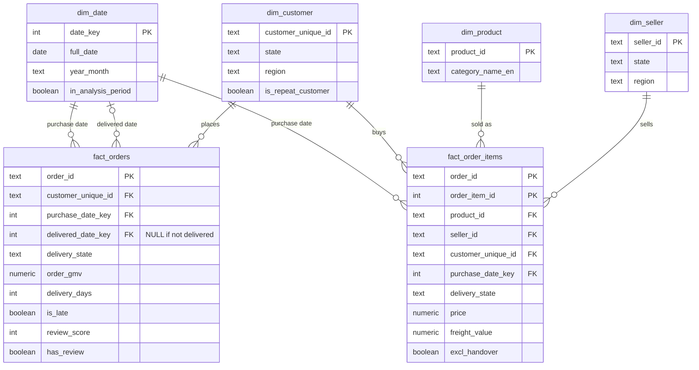

# 03 — Data Model (Star Schema)

## Summary

**The analysis uses two fact tables at their natural grains, sharing four
conformed dimensions.** Item-level questions (categories, sellers, freight) use
`fact_order_items`; order-level questions (repeat buying, delivery, ratings) use
`fact_orders`. Keeping delivery and review measures
at order grain prevents them being counted once per item.

## Model diagram

## Fact tables

| Table | Grain | Used for | Key measures |
|---|---|---|---|
| `fact_order_items` | One item line in an order | BQ1, BQ4, BQ5 | price (GMV), freight_value, freight_share; delivery_state and delivery_region copied from the order |
| `fact_orders` | One order | BQ2, BQ3, BQ5 | order_gmv, delivery_days, days_vs_estimate, is_late, review_score |

The two facts are not joined directly; they share `order_id` as a degenerate
dimension and connect through the conformed dimensions.

## Dimensions

| Dimension | Key | Main attributes |
|---|---|---|
| `dim_date` | date_key | date, year, quarter, month, year-month, weekday, in_analysis_period |
| `dim_customer` | customer_unique_id | city, state, region, first_order_date, orders_count, is_repeat_customer |
| `dim_product` | product_id | category (Portuguese and English), weight, dimensions |
| `dim_seller` | seller_id | city, state, region |

## Design decisions

| Decision | Reason |
|---|---|
| Two fact tables (item and order grain) | Delivery and review measures belong to orders; at item grain they would be counted once per item |
| Customer identified by `customer_unique_id` | `customer_id` is unique per order (T2) |
| Delivery state stored on `fact_orders` | A customer's address can differ between orders; BQ3 and BQ5 need the state at the time of the order |
| Region stored as a dimension attribute | Avoids a snowflake; simpler for Power BI |
| Exclusions stored as flags, not deleted rows | Keeps data complete; each analysis filters as needed; allows with/without sensitivity checks |
| Payments not modelled | GMV uses item prices; payments were a reconciliation check only |
| Delivery state and region also stored on `fact_order_items` | BQ5 analyses freight by category and region at item level; copying the order's delivery location avoids joining the two fact tables | `dim_date` used twice by `fact_orders` (purchase and delivered date) | Role-playing dimension: one date table, two relationships; in Power BI the delivered-date relationship is inactive and used via USERELATIONSHIP |