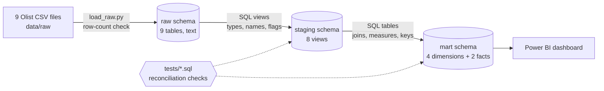

# 04 — ETL Pipeline

## Summary

**A reproducible ETL pipeline (ELT pattern) loads 1,550,622 rows from 9 Olist
source files into PostgreSQL and transforms them into a tested star schema.**
Data moves through three layers: `raw` (as delivered), `staging` (typed and
cleaned) and `mart` (dimensional model for analysis and Power BI). Every layer
is rebuilt from scripts in the repository, and each step is checked against
independently verified numbers.

## Architecture

**ETL or ELT?** Data is loaded into the database unchanged and transformed there
with SQL: the ELT pattern, standard for database-centred analytics. The term ETL
is used for the overall process.

## Layers

| Layer | Schema | Built by | Purpose |
|---|---|---|---|
| Extract | — | Kaggle download into `data/raw` | Source files kept unchanged; not stored in Git |
| Load | `raw` | `src/load_raw.py` | Exact copy of the 9 CSV files, every column as text |
| Transform: staging | `staging` | `sql/staging/*.sql` | Correct types, consistent names, data-quality flags |
| Transform: marts | `mart` | `sql/marts/*.sql` | Star schema with keys, measures and business logic |

## Extract and load

- **Source:** Olist Brazilian E-Commerce public dataset, 9 CSV files (~126 MB).
- **Loader:** `src/load_raw.py` reads each file with pandas and writes it to the
  `raw` schema with SQLAlchemy.
- **No silent conversion:** every column is loaded as text, so values such as
  zip codes keep their leading zeros. Types are set in staging, in SQL.
- **Rerunnable:** each run replaces the raw tables, so repeated runs never
  duplicate rows.
- **Validated:** the loader compares row counts between each file and its table
  and reports OK or MISMATCH (all 9 tables OK).
- **Secure:** database credentials are read from a `.env` file excluded from Git.

## Transform: staging (8 views)

| View | Source | Applied |
|---|---|---|
| `stg_orders` | orders | Types; flags T1 (analysis period), T3, T4 |
| `stg_order_items` | order_items | Types; `order_item_id` as integer |
| `stg_order_reviews` | order_reviews | T6: flag the latest review per order |
| `stg_customers` | customers | T2: exposes `customer_unique_id` |
| `stg_sellers` | sellers | Types and names |
| `stg_products` | products | T8: missing category = `unknown`; source typos corrected |
| `stg_category_translation` | category_translation | T9: two missing translations added |
| `stg_state_region` | reference values | State → region mapping, defined once |

Rules: one view per source table, no rows deleted, exclusions recorded as flags.
Treatment codes (T1–T9) refer to the decision log in
`docs/02_data_quality_findings.md`.

## Transform: marts (star schema)

| Table | Grain | Keys |
|---|---|---|
| `dim_date` | One calendar day, 2016–2018 | `date_key` (YYYYMMDD) |
| `dim_customer` | One person | `customer_unique_id` |
| `dim_product` | One product | `product_id` |
| `dim_seller` | One seller | `seller_id` |
| `fact_order_items` | One item line | `order_id` + `order_item_id`; 4 foreign keys |
| `fact_orders` | One order | `order_id`; 3 foreign keys |

Primary and foreign keys are enforced by the database, so a wrong grain or an
orphan row stops the build. Design details: `docs/03_data_model.md`.

## Data quality controls

| Control | Example |
|---|---|
| Load validation | Rows in each CSV = rows in its raw table (1,550,622) |
| Key checks | Every primary key unique; every foreign key resolves |
| Reconciliation across layers | Item value equal in staging, `fact_order_items` and `fact_orders` (R$ 13,591,643.70) |
| Reconciliation to profiling | Delivered orders 96,478; orders without items 775; reviewed orders 98,673 |
| Logic checks | No negative delivery times; impossible handover dates already flagged |

Test queries: `tests/test_stg_*.sql`, `tests/test_mart_*.sql`.

## Design principles

- **Idempotent:** every script drops and rebuilds its object, so reruns are safe.
- **Fail loudly:** bad values stop the build instead of being filtered out silently.
- **Flags, not deletion:** excluded rows stay in the data, marked for each analysis.
- **Single source of logic:** shared rules (regions, translations) are defined once.

## How to run (current)

1. Download the dataset from Kaggle into `data/raw`.
2. Create `.env` with the PostgreSQL connection settings.
3. Run `py src/load_raw.py`.
4. Run the SQL files in order: `sql/staging/*.sql`, then `sql/marts/dim_*.sql`,
   then `fact_order_items.sql`, then `fact_orders.sql`.
5. Run the test files in `tests/`.

Automating steps 3–5 into a single command (`run_pipeline.py`) is in progress.